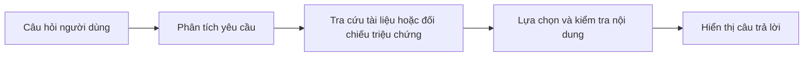
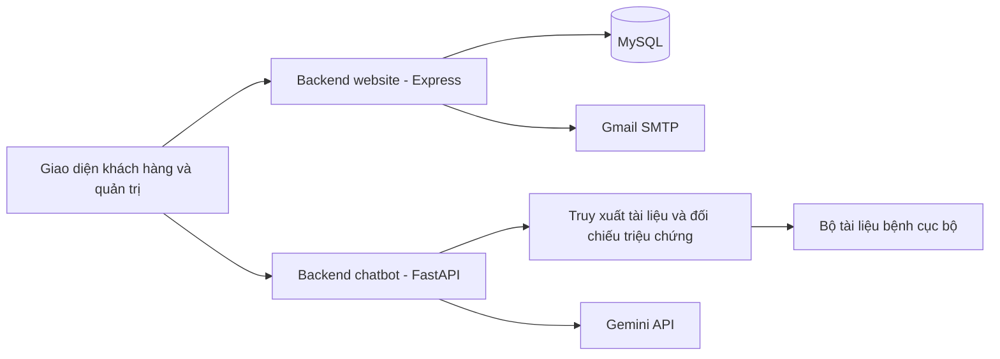

# Icare Clinic – Website quản lý phòng khám tích hợp AI Chatbot

**Icare Clinic kết hợp website đặt lịch, quản lý hồ sơ và quản trị phòng khám với chatbot AI hỗ trợ tra cứu thông tin y tế bằng tiếng Việt.**

Dự án triển khai cả giao diện, backend nghiệp vụ, cơ sở dữ liệu và chatbot truy xuất theo hướng **RAG** và kiểm tra đầu ra dựa trên tài liệu.

## 1. Tổng quan dự án

### 1.1. Giới thiệu

Icare Clinic hướng đến hai nhu cầu: hỗ trợ khách hàng sử dụng dịch vụ phòng khám trực tuyến và cung cấp công cụ tìm hiểu thông tin sức khỏe ngay trên website.

Với website, khách hàng có thể tạo tài khoản, cập nhật hồ sơ, xem bác sĩ theo chuyên khoa, đặt lịch và theo dõi lịch khám. Quản trị viên có khu vực riêng để quản lý danh mục, tài khoản, hồ sơ, lịch sử khám và các lịch hẹn.

Với AI chatbot, người dùng có thể hỏi về bệnh, nguyên nhân, triệu chứng hoặc mô tả các dấu hiệu đang gặp. Hệ thống truy xuất nội dung liên quan, lựa chọn câu trả lời từ nguồn và nhắc người dùng thăm khám khi cần xác định nguyên nhân.

### 1.2. Mục tiêu

| Website phòng khám | AI chatbot y tế |
| --- | --- |
| Xây dựng giao diện cho khách hàng và quản trị viên | Hỏi đáp tiếng Việt dựa trên bộ tài liệu bệnh |
| Số hóa đặt lịch, hồ sơ và lịch sử khám | Nhận diện bệnh, chủ đề và đối chiếu triệu chứng |
| Quản lý tài khoản, email và khôi phục mật khẩu | Kết hợp BM25, metadata và Gemini để chọn nội dung |
| Kiểm tra phiên, phân quyền và quyền sở hữu dữ liệu | Kiểm soát chất lượng và nội dung câu trả lời |
| Chuẩn bị database mẫu để người khác cài đặt | Tích hợp chatbot trực tiếp vào giao diện web |

### 1.3. Phạm vi triển khai

Website được xây dựng bằng HTML/CSS/JavaScript, Node.js, Express và MySQL. Các chức năng backend website tập trung trong `server.js`; mã giao diện được tổ chức theo từng nhóm màn hình.

Chatbot sử dụng Python, FastAPI và mô hình Gemini thông qua API, kết hợp bộ tài liệu y tế cục bộ để hỗ trợ hỏi đáp. Thành phần AI tập trung vào xử lý tiếng Việt, tìm kiếm thông tin phù hợp và kiểm soát nội dung trả lời.

## 2. Chức năng website phòng khám

### 2.1. Tài khoản và thông tin cá nhân

- Đăng ký bằng thông tin cá nhân, số điện thoại, email và mật khẩu.
- Đăng nhập bằng số điện thoại, mật khẩu; phân biệt khách hàng và quản trị viên.
- Xem, cập nhật hồ sơ cá nhân và đổi mật khẩu.
- Bổ sung hoặc thay đổi email sau khi xác thực tài khoản; xác minh địa chỉ mới qua thư.
- Khôi phục mật khẩu bằng liên kết gửi đến email đã được xác minh.


### 2.2. Tra cứu bác sĩ và đặt lịch

Khách hàng chọn chuyên khoa, bác sĩ, ngày và giờ khám, sau đó nhập thông tin cùng lý do khám. Backend kiểm tra dữ liệu và tình trạng khung giờ trước khi ghi nhận lịch hẹn.

Người dùng có thể xem danh sách lịch của mình, theo dõi trạng thái và hủy lịch khi đáp ứng điều kiện. Các khung giờ được hiển thị để khách hàng lựa chọn khi đặt lịch.

### 2.3. Hồ sơ y tế và lịch sử khám

Khách hàng có màn hình xem hồ sơ y tế và lịch sử khám gắn với tài khoản của mình. Thông tin lịch sử gồm ngày khám, bác sĩ, chuyên khoa, kết luận và chi tiết được lưu trong database.

### 2.4. Khu vực quản trị

| Nhóm chức năng | Nội dung |
| --- | --- |
| Tổng quan | Thống kê số hồ sơ, bác sĩ, lịch hôm nay và lịch chờ xác nhận |
| Chuyên khoa | Xem, thêm, sửa và xóa danh mục theo điều kiện dữ liệu |
| Bác sĩ | Quản lý thông tin bác sĩ, học vị và chuyên khoa |
| Tài khoản | Xem, quản lý tài khoản khách hàng |
| Lịch khám | Tạo, cập nhật, xử lý trạng thái và quản lý lịch hẹn |
| Hồ sơ y tế | Tra cứu và quản lý hồ sơ của khách hàng |
| Lịch sử khám | Ghi nhận, cập nhật kết luận và thông tin từng lần khám |
| Hoạt động | Theo dõi danh sách hoạt động được hệ thống ghi nhận |


### 2.5. Xác thực, email và bảo vệ dữ liệu

Hệ thống sử dụng Argon2id để băm mật khẩu, quản lý phiên đăng nhập và phân quyền giữa khách hàng với quản trị viên. Các chức năng tài khoản có kiểm tra dữ liệu và giới hạn yêu cầu để hạn chế lạm dụng.

Email xác minh và khôi phục mật khẩu được gửi qua Nodemailer kết hợp Gmail SMTP. Liên kết có thời hạn, chỉ dùng một lần; phản hồi quên mật khẩu không tiết lộ tài khoản có tồn tại hay không.

## 3. AI chatbot y tế

### 3.1. Hỏi đáp thông tin bệnh

Chatbot hỗ trợ người dùng tìm hiểu định nghĩa, nguyên nhân, triệu chứng, biến chứng và cách phòng ngừa trong phạm vi tài liệu của dự án. Người dùng có thể đặt câu hỏi bằng tiếng Việt ngay trên website.

### 3.2. Gợi ý từ mô tả triệu chứng

Người dùng có thể mô tả các dấu hiệu đang gặp để chatbot đối chiếu với dữ liệu và đưa ra những bệnh có biểu hiện tương đồng. Câu trả lời nêu các dấu hiệu liên quan và nhắc người dùng gặp nhân viên y tế để xác định nguyên nhân.

Khi chưa đủ thông tin, chatbot yêu cầu bổ sung mô tả thay vì đưa ra kết luận. Các gợi ý chỉ mang tính tham khảo.

### 3.3. Công nghệ ứng dụng

| Công nghệ/kỹ thuật | Ứng dụng trong chatbot |
| --- | --- |
| Gemini | Lựa chọn thông tin phù hợp với câu hỏi từ tài liệu được cung cấp |
| RAG | Kết hợp truy xuất tài liệu với mô hình ngôn ngữ để hỗ trợ hỏi đáp |
| BM25 | Tìm kiếm và xếp hạng nội dung liên quan |
| Xử lý tiếng Việt | Hỗ trợ nhận diện tên bệnh, chủ đề và cách diễn đạt của người dùng |
| Đối chiếu triệu chứng | Tìm các biểu hiện tương đồng dựa trên dữ liệu và quy tắc |
| Kiểm tra đầu ra | Đối chiếu câu trả lời với nguồn để hạn chế nội dung không có căn cứ |

### 3.4. Nguyên lý hoạt động



### 3.5. Trải nghiệm và phạm vi sử dụng

Khung chat trình bày câu trả lời theo đoạn, danh sách và từ khóa nổi bật. Khi thiếu dữ liệu hoặc nhận diện dấu hiệu nguy hiểm trong phạm vi được hỗ trợ, chatbot đưa ra thông báo phù hợp.

Chatbot hỗ trợ tra cứu thông tin, không thay thế thăm khám và không kê đơn cá nhân. Dữ liệu hiện chưa được thẩm định y khoa; chất lượng phản hồi phụ thuộc vào nguồn tài liệu và khả năng nhận diện câu hỏi.

## 4. Kiến trúc và công nghệ

### 4.1. Kiến trúc tổng thể



Hai backend có trách nhiệm riêng: Express phục vụ giao diện và nghiệp vụ phòng khám; FastAPI xử lý câu hỏi y tế. Trình duyệt gửi yêu cầu đến backend tương ứng. MySQL lưu dữ liệu nghiệp vụ, còn chatbot đọc kiến thức từ các file trong `data/y-te/`.

### 4.2. Công nghệ website

| Công nghệ | Vai trò |
| --- | --- |
| HTML, CSS, JavaScript | Giao diện khách hàng, quản trị và khung chat |
| Node.js, Express | API nghiệp vụ, phục vụ file giao diện |
| MySQL, mysql2 | Lưu dữ liệu và thực hiện truy vấn |
| express-session | Quản lý phiên đăng nhập tại backend |
| Argon2id | Băm và kiểm tra mật khẩu |
| Nodemailer, Gmail SMTP | Gửi liên kết xác minh và khôi phục mật khẩu |
| Helmet, CORS, express-rate-limit | Header bảo mật, origin và giới hạn yêu cầu cho backend website |
| Validator, CSRF token | Kiểm tra dữ liệu và bảo vệ thao tác thay đổi trạng thái |

### 4.3. Công nghệ AI chatbot

| Công nghệ/kỹ thuật | Vai trò |
| --- | --- |
| Python, FastAPI, Uvicorn, Pydantic | Xây dựng và vận hành API chatbot |
| Gemini 2.5 Flash | LLM chọn nội dung phù hợp từ ngữ cảnh |
| BM25 và metadata | Xếp hạng, lọc đúng bệnh và chủ đề |
| Chuẩn hóa và so khớp văn bản | Xử lý tiếng Việt và nhận diện yêu cầu |
| Prompt engineering | Định hướng mô hình trả lời dựa trên tài liệu |
| JSONL, JSON, Markdown | Tổ chức dữ liệu và tài liệu y tế |
| OpenAI SDK | Kết nối Gemini qua API tương thích OpenAI |

## 5. Cơ sở dữ liệu và dữ liệu AI

### 5.1. Database website

Schema gồm 10 bảng nghiệp vụ và hai bảng hỗ trợ xác thực:

| Nhóm bảng | Chức năng |
| --- | --- |
| `khachhang`, `quantrivien` | Tài khoản, mật khẩu băm, email và trạng thái xác minh |
| `khoa`, `bacsi` | Chuyên khoa và bác sĩ |
| `lichkham` | Lịch hẹn, khung giờ và trạng thái xử lý |
| `hosoyte`, `lichsukhambenh` | Hồ sơ và thông tin từng lần khám |
| `hoatdong`, `lienhe`, `ai` | Hoạt động và các bảng thông tin theo schema hiện có |
| `app_sessions`, `account_email_tokens` | Phiên đăng nhập và token email |

Bảng `ai` được giữ trong schema; chatbot hiện đọc bộ tài liệu cục bộ. Database mẫu chỉ có **6 chuyên khoa và 12 bác sĩ hư cấu**, các bảng còn lại để trống. Người clone tự tạo dữ liệu tài khoản, lịch hẹn và hồ sơ trên database của mình.

### 5.2. Bộ dữ liệu chatbot

Bộ tài liệu gồm các bài viết về bệnh, được tổ chức thành những phần nội dung phục vụ tìm kiếm và hỏi đáp.

| File | Vai trò |
| --- | --- |
| `data/y-te/benh_chunks.jsonl` | Nội dung chunk và metadata truy xuất |
| `data/y-te/benh_index.json` | Chỉ mục bài, tên bệnh và định danh |
| `data/y-te/Benh.md` | Đối chiếu nội dung khi nạp dữ liệu |

Dữ liệu được kiểm tra trước khi sử dụng cho chatbot. Bộ tài liệu hiện chưa được thẩm định y khoa và cần tiếp tục rà soát về chất lượng.

## 6. Cấu trúc mã nguồn

```text
Icare Clinic/
├── chatbot_server.py          Pipeline AI và API chatbot
├── data/y-te/
│   ├── benh_chunks.jsonl       Nội dung chunk và metadata
│   ├── benh_index.json         Chỉ mục bài và bệnh
│   └── Benh.md                 Đối chiếu nội dung
├── public/
│   ├── assets/
│   │   ├── js/chatbot.js       Gửi câu hỏi và dựng phản hồi
│   │   ├── css/chatbot.css     Bố cục khung chat
│   │   └── images/            Ảnh và logo dùng chung
│   ├── khach-hang/             Trang chủ, tài khoản, hồ sơ và đặt lịch
│   ├── quan-tri/               Giao diện quản trị
│   └── tai-khoan/              Xác minh email và khôi phục mật khẩu
├── server.js                  Backend website và nghiệp vụ phòng khám
├── database/
│   ├── migrations/
│   │   ├── 000_initial_schema.sql
│   │   ├── 001_sessions.sql
│   │   └── 002_account_email_tokens.sql
│   └── icare_clinic_demo.sql   Chuyên khoa và bác sĩ hư cấu
├── .env.example               Cấu hình mẫu
├── .gitignore
├── .gitattributes
├── requirements.txt           Thư viện Python
├── package.json
├── package-lock.json
└── README.md
```

`server.js` phụ trách backend website; `chatbot_server.py` phụ trách dịch vụ chatbot. Giao diện, database và tài liệu y tế được tổ chức trong các thư mục riêng.

## 7. Cài đặt và chạy dự án

### 7.1. Yêu cầu môi trường

| Thành phần | Yêu cầu |
| --- | --- |
| Python | 3.11 trở lên để chạy chatbot |
| Gemini API key | Khóa hợp lệ để sử dụng nhánh hỏi đáp qua LLM |
| Node.js | 22 trở lên, kèm npm, để chạy website |
| MySQL | 8.0 trở lên cho các chức năng phòng khám |
| Công cụ database | MySQL Workbench hoặc công cụ nhập SQL tương đương |
| Trình duyệt | Hỗ trợ JavaScript và cookie |

Có thể chạy riêng API chatbot để trình diễn phần AI. Website cần thêm Node.js và MySQL. Internet phục vụ cài thư viện, gọi Gemini, gửi email và tải các tài nguyên giao diện dùng qua CDN.

### 7.2. Chạy riêng backend AI

Tại thư mục gốc dự án:

```powershell
python -m pip install -r requirements.txt
if (-not (Test-Path .env)) { Copy-Item .env.example .env }
```

Điền `GEMINI_API_KEY` trong `.env`, giữ đúng ba file ở `data/y-te/`, sau đó chạy:

```powershell
python -m uvicorn chatbot_server:app --host 127.0.0.1 --port 8000
```

Mở **http://127.0.0.1:8000/health** để xem trạng thái dữ liệu và cấu hình, hoặc **http://127.0.0.1:8000/docs** để gửi yêu cầu thử đến `/chat`. API chatbot không cần MySQL để nạp kiến thức và xử lý câu hỏi.

### 7.3. Chuẩn bị website và database mẫu

```powershell
npm.cmd ci
```

Trong MySQL Workbench, tạo và chọn schema riêng:

```sql
CREATE DATABASE IF NOT EXISTS icare_clinic_demo
  CHARACTER SET utf8mb4 COLLATE utf8mb4_0900_ai_ci;
USE icare_clinic_demo;
```

Chạy lần lượt trước khi khởi động website:

| Thứ tự | File | Nội dung |
| --- | --- | --- |
| 1 | [000_initial_schema.sql](database/migrations/000_initial_schema.sql) | Các bảng nghiệp vụ |
| 2 | [001_sessions.sql](database/migrations/001_sessions.sql) | Phiên đăng nhập |
| 3 | [002_account_email_tokens.sql](database/migrations/002_account_email_tokens.sql) | Token email |
| 4 | [icare_clinic_demo.sql](database/icare_clinic_demo.sql) | 6 chuyên khoa và 12 bác sĩ mẫu |

File mẫu chỉ thêm danh mục khi toàn bộ các bảng ứng dụng còn trống. Dữ liệu khách hàng, quản trị viên, hồ sơ, lịch hẹn và lịch sử khám cũ không được chia sẻ. Các file SQL không tự chạy khi ứng dụng khởi động và không tự nâng cấp bảng đã tồn tại.

### 7.4. Cấu hình môi trường

| Nhóm | Biến cấu hình |
| --- | --- |
| AI | `GEMINI_API_KEY` |
| MySQL | `DB_HOST`, `DB_PORT`, `DB_NAME`, `DB_USER`, `DB_PASSWORD` |
| Phiên đăng nhập | `SESSION_SECRET` |
| Website | `PORT`, `ALLOWED_ORIGINS`, `APP_BASE_URL`, `NODE_ENV` |
| Email | `SMTP_HOST`, `SMTP_PORT`, `SMTP_USER`, `SMTP_APP_PASSWORD` |

`DB_NAME=icare_clinic_demo` phải khớp với schema được tạo. Người chạy sử dụng tài khoản MySQL của mình, có quyền truy cập schema đó. Tên file SQL không tự đổi tên database.

Tạo `SESSION_SECRET` ngẫu nhiên tối thiểu 32 ký tự cho backend website, rồi lưu kết quả vào `.env`:

```powershell
node -e "console.log(require('node:crypto').randomBytes(32).toString('hex'))"
```

Để dùng email, bật xác minh hai bước cho Gmail, tạo [Mật khẩu ứng dụng Google](https://support.google.com/accounts/answer/185833) và cấu hình `smtp.gmail.com`, cổng `465`. `APP_BASE_URL` phải thuộc `ALLOWED_ORIGINS` và truy cập được từ liên kết email.

### 7.5. Chạy giao diện tích hợp

Giữ backend chatbot chạy ở cổng 8000 và mở terminal khác:

```powershell
npm.cmd start
```

Truy cập **http://localhost:3000/** rồi mở khung chat. Khi phát triển có thể dùng `npm.cmd run dev` và thêm `--reload` vào lệnh Uvicorn.

Trên macOS/Linux có thể dùng `npm` thay cho `npm.cmd`, `python3` thay cho `python` tùy cấu hình máy. Khi dùng LAN hoặc reverse proxy, cấu hình origin và endpoint phù hợp; giao diện hỗ trợ meta `icare-chat-endpoint`.

